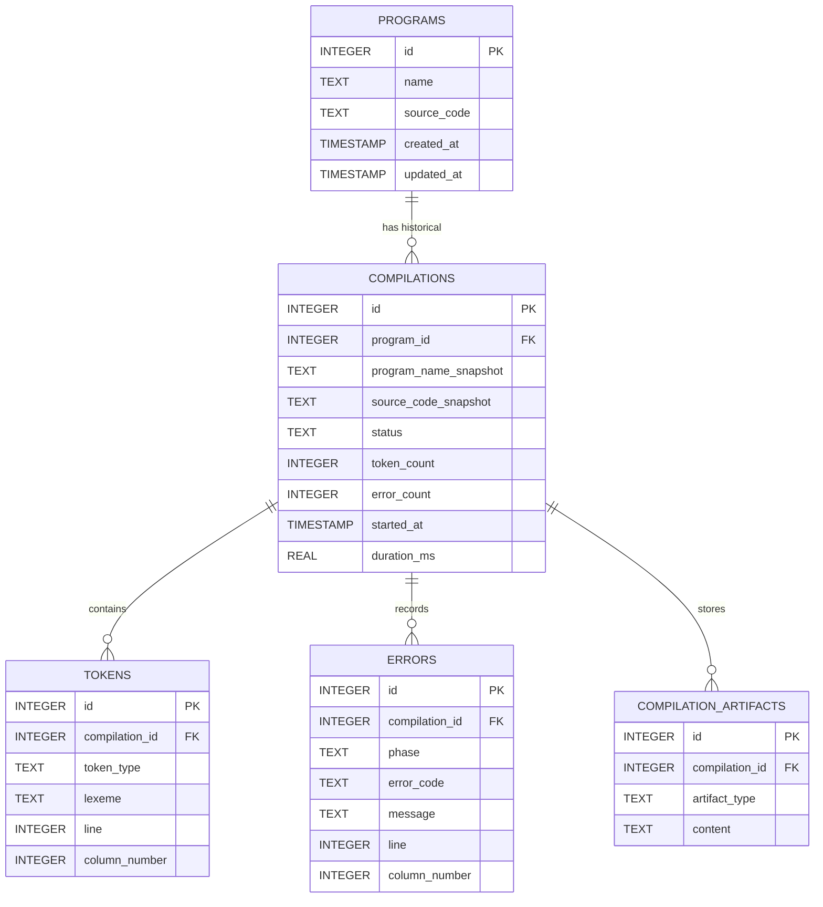

# Smart Lexical Analyzer and Syntax Checker Using Python

[](https://www.python.org/)
[](https://streamlit.io/)
[](https://www.sqlite.org/)
[-brightgreen.svg)](https://pytest.org/)
[]()

> **A Technical Enhancement Course (TEC) Mini-Project**  
> **Course:** Compiler Design (Subject Code: 5CS221PC)  
> **Department:** Computer Science and Engineering  
> **Institution:** Shri Sant Gajanan Maharaj College of Engineering (SSGMCE), Shegaon  
> **Academic Session:** Autumn/Winter 2026–2027  

---

## 1. Project Overview

The **Smart Lexical Analyzer and Syntax Checker** is a professional, educational compiler engineering application built with **Python 3.12**, **Streamlit**, and **SQLite**. It offers third-year computer science students and faculty evaluators an interactive workbench to examine the inner mechanics of a compiler pipeline in real time.

The application accepts source code written in a clearly defined, deterministic subset of C-like syntax, tokenizes it into classified tokens with 1-based spatial tracking (line and column coordinates), checks syntactic structure using a hand-crafted **Recursive-Descent Parser**, performs semantic symbol validation, generates linearized **Three-Address Code (TAC)**, and persists compilation telemetry in a normalized local SQLite database (`compiler.db`).

---

## 2. Problem Statement & Motivation

Traditional compiler laboratory assignments frequently depend on legacy Unix utilities such as `lex`, `yacc`, `flex`, or `bison`. While historically significant, these tools present severe pedagogical hurdles:
- They require complex, platform-dependent external toolchains.
- Parser generator error messages are notoriously cryptic, hindering learning.
- They lack visual and interactive inspection of tokens, trees, and symbol tables.

This project solves these limitations by implementing a clean, transparent, pure-Python compiler front-end with an intuitive web GUI, making compiler principles easy to explore, test, and defend during viva voce examinations.

---

## 3. Key Features

- **Lexical Analysis (Scanner):**
  - Regex-driven tokenizer classifying keywords (`int`, `float`, `print`), identifiers, integer literals, floating-point literals, arithmetic operators (`+`, `-`, `*`, `/`), assignment (`=`), and separators (`;`, `(`, `)`).
  - Accurate 1-based line number and column number tracking.
  - Strips single-line comments (`//...`) and whitespace without disturbing coordinates.
  - Resilient scanner detecting illegal characters (`LEX001`), malformed numbers (`LEX002`), and bad identifiers (`LEX003`).

- **Syntax Analysis (Recursive-Descent Parser):**
  - Top-down recursive-descent parser constructing a strongly-typed Abstract Syntax Tree (AST).
  - Enforces algebraic operator precedence: parentheses first, multiplication/division before addition/subtraction.
  - Panic-mode error synchronization: reports multiple syntax errors in a single compilation run.

- **Semantic Analysis & Symbol Table:**
  - In-memory symbol table tracking variable name, type, declared location, and initialization status.
  - Detects duplicate variable declarations (`SEM001`).
  - Detects undeclared variable usage in expressions and assignments (`SEM002`).
  - Flags uninitialized variable reads (`SEM003`).
  - Detects compile-time static division by zero (`SEM004`).
  - Provides type mismatch/narrowing warnings (`SEM005`).

- **Intermediate Code Generation (Three-Address Code):**
  - Linearizes AST expressions into standard Three-Address Code (3AC) with temporary variables (`t1`, `t2`, ...).
  - Preserves evaluation order and grouping.
  - Downloadable as a `.tac` file.

- **Relational Persistence (SQLite):**
  - Auto-initializes `compiler.db` with foreign-key enforcement enabled (`PRAGMA foreign_keys = ON;`).
  - Stores saved programs, compilation run snapshots, individual tokens, error diagnostics, and AST/TAC artifacts.
  - Never loses failed compilation records.

- **Interactive Streamlit Web GUI:**
  - **Dashboard:** Real-time metrics (total programs, compilation counts, pass rate, recent history).
  - **Code Analyzer:** Multiline editor, sample loader, run/save controls, tabbed outputs for Tokens, AST, Symbol Table, TAC, and Errors.
  - **Token Analysis:** Interactive table with category filters and CSV export.
  - **Error Report:** Structured diagnostics with line/column markers and remediation tips.
  - **Saved Programs:** Manage, search, load, rename, and delete saved scripts.
  - **Compilation History:** Searchable audit trail with deep run inspection.
  - **About & Help:** Complete EBNF grammar reference and viva preparation guide.

- **Robust Automated Testing:**
  - 37 automated pytest tests covering all compiler modules with a 100% pass rate.

- **Security Guarantee:**
  - **Zero code execution risk:** The application never invokes `eval()` or `exec()`.

---

## 4. Compiler Workflow & Pipeline Architecture

```mermaid
flowchart TD
    Src["Source Code (C-like Input)"] --> Lexer["1. Lexical Analyzer (Scanner)"]
    Lexer -->|Token Stream + Coordinates| Parser["2. Syntax Analyzer (Parser)"]
    Lexer -->|Lexical Errors| Diag["Centralized Diagnostics"]
    Parser -->|Abstract Syntax Tree (AST)| Semantic["3. Semantic Analyzer & Symbol Table"]
    Parser -->|Syntax Errors| Diag
    Semantic -->|Decorated AST + Symbol Table| TAC["4. Intermediate Code Generator (TAC)"]
    Semantic -->|Semantic Errors| Diag
    TAC -->|Three-Address Code Instructions| Out["Compilation Result"]
    Diag --> Out
    Out --> Repo["SQLite Repository Layer (compiler.db)"]
    Out --> UI["Streamlit Interactive GUI"]
```

---

## 5. Supported Grammar (EBNF)

```ebnf
program         = { statement } , EOF ;

statement       = declaration
                | assignment
                | print_statement ;

declaration     = TYPE , IDENTIFIER , "=" , expression , ";" ;
assignment      = IDENTIFIER , "=" , expression , ";" ;
print_statement = "print" , "(" , expression , ")" , ";" ;

expression      = term , { ( "+" | "-" ) , term } ;
term            = factor , { ( "*" | "/" ) , factor } ;
factor          = NUMBER
                | IDENTIFIER
                | "(" , expression , ")"
                | unary_expression ;

unary_expression = ( "+" | "-" ) , factor ;
TYPE            = "int" | "float" ;
NUMBER          = INT_LITERAL | FLOAT_LITERAL ;
```

### Operator Precedence Hierarchy

| Level | Operator | Category | Associativity | Description |
| :---: | :---: | :---: | :---: | :--- |
| **1 (Highest)** | `( )` | Primary / Grouping | N/A | Sub-expressions evaluated first |
| **2** | `+`, `-` | Unary | Right-to-Left | Unary sign operators |
| **3** | `*`, `/` | Multiplicative | Left-to-Right | Multiplication & Division |
| **4** | `+`, `-` | Additive | Left-to-Right | Addition & Subtraction |
| **5 (Lowest)** | `=` | Assignment | Right-to-Left | Store expression result into variable |

---

## 6. Sample Input & Output Demonstration

### Input Source Code
```c
// Sample Program: Precedence & Arithmetic
int a = 10;
float b = 5.5;
int c = (a + 5) * 2;
print(c);
```

### Token Stream (Preview)
| Line | Col | Token Type | Category | Lexeme | Value |
| :---: | :---: | :--- | :--- | :--- | :--- |
| 2 | 1 | `KEYWORD_INT` | Keyword | `int` | `None` |
| 2 | 5 | `IDENTIFIER` | Identifier | `a` | `None` |
| 2 | 7 | `OP_ASSIGN` | Operator | `=` | `None` |
| 2 | 9 | `INT_LITERAL` | Literal | `10` | `10` |
| 2 | 11 | `SEMICOLON` | Separator | `;` | `None` |

### Generated Three-Address Code (TAC)
```c
a = 10                         # declare int a
b = 5.5                        # declare float b
t1 = a + 5
t2 = t1 * 2
c = t2                         # declare int c
print c                        # output value
```

---

## 7. Database Schema (SQLite)

The persistence model is defined in `database/schema.sql` and stored in `compiler.db`:



---

## 8. Project Directory Structure

```
LexAnalyzer_CD/
├── app.py                      # Streamlit interactive web application
├── requirements.txt            # Project dependencies
├── README.md                   # Comprehensive project documentation
├── .gitignore                  # Git ignore rules
│
├── .streamlit/
│   └── config.toml             # Streamlit visual theme configuration
│
├── compiler/                   # Core compiler subsystem
│   ├── __init__.py             # Package exports
│   ├── tokens.py               # Token types, Token class, keywords
│   ├── lexer.py                # Regex scanner with line/col tracking
│   ├── ast_nodes.py            # Strongly-typed AST dataclasses
│   ├── parser.py               # Recursive-descent parser with error recovery
│   ├── semantic.py             # Symbol table and semantic verification
│   ├── tac.py                  # Three-Address Code generator
│   ├── diagnostics.py          # Centralized error reporting & CompilationResult
│   └── pipeline.py             # Unified compiler pipeline runner
│
├── database/                   # Relational SQLite persistence subsystem
│   ├── __init__.py             # Package exports
│   ├── schema.sql              # DDL schema script with foreign keys & indexes
│   ├── db.py                   # Database connection manager with PRAGMA foreign_keys
│   └── repository.py           # Parameterized DAO repository layer
│
├── samples/
│   └── sample_programs.json    # 13 curated educational programs with expected results
│
├── tests/                      # Automated test suite (37 pytest tests)
│   ├── __init__.py
│   ├── test_lexer.py           # Lexer unit tests (9 tests)
│   ├── test_parser.py          # Parser unit tests (10 tests)
│   ├── test_semantic.py        # Semantic analyzer unit tests (5 tests)
│   ├── test_tac.py             # Intermediate code tests (4 tests)
│   ├── test_pipeline.py        # Unified pipeline tests (4 tests)
│   └── test_database.py        # SQLite repository tests (5 tests)
│
├── docs/                       # Technical documentation & college reports
│   ├── grammar.md              # EBNF grammar & precedence tables
│   ├── architecture.md         # System architecture & component design
│   ├── database_schema.md      # Data dictionary & ER diagrams
│   ├── test_results.md         # Execution report for 37 tests
│   ├── viva_questions.md       # 30+ comprehensive viva defense questions & answers
│   ├── report_outline.md       # College report outline & page budget
│   ├── report.md               # Complete 12-page project report (Markdown)
│   ├── generate_report_docx.py # Automated Word .docx report generator
│   └── TEC_Project_Report.docx # Formatted editable Word report for college submission
│
└── screenshots/
    └── README.md               # Application screenshot guide
```

---

## 9. Installation & Execution Guide

### Windows PowerShell Execution

```powershell
# 1. Clone repository or navigate to project directory
cd "C:\Users\ASUS\OneDrive\Desktop\CD Project\LexAnalyzer_CD"

# 2. Create Python virtual environment (recommended)
python -m venv .venv

# 3. Activate virtual environment
.\.venv\Scripts\Activate.ps1

# (If PowerShell displays an Execution_Policy error, run):
# Set-ExecutionPolicy -Scope Process -ExecutionPolicy Bypass

# 4. Upgrade pip and install dependencies
python -m pip install --upgrade pip
pip install -r requirements.txt

# 5. Launch the Streamlit Web Application
streamlit run app.py
```

The application will open automatically in your browser at `http://localhost:8501`.

---

## 10. Automated Testing

Execute the complete test suite via `pytest`:

```powershell
python -m pytest -v
```

### Test Results Overview
```
============================= test session starts =============================
platform win32 -- Python 3.12.10, pytest-9.1.1
collected 37 items

tests/test_database.py::test_program_crud_operations PASSED              [  2%]
tests/test_database.py::test_record_successful_compilation PASSED        [  5%]
tests/test_database.py::test_record_failed_compilation PASSED            [  8%]
tests/test_database.py::test_foreign_key_enforcement PASSED              [ 10%]
tests/test_database.py::test_dashboard_statistics PASSED                 [ 13%]
tests/test_lexer.py::test_keywords_recognition PASSED                    [ 16%]
tests/test_lexer.py::test_keyword_vs_longer_identifier PASSED            [ 18%]
tests/test_lexer.py::test_integer_and_float_literals PASSED              [ 21%]
tests/test_lexer.py::test_operators_and_delimiters PASSED                [ 24%]
tests/test_lexer.py::test_line_and_column_tracking PASSED                [ 27%]
tests/test_lexer.py::test_comments_and_whitespace_ignored PASSED         [ 29%]
tests/test_lexer.py::test_unrecognized_characters_detection PASSED       [ 32%]
tests/test_lexer.py::test_malformed_numeric_literal PASSED               [ 35%]
tests/test_lexer.py::test_invalid_identifier_starting_with_digit PASSED  [ 37%]
tests/test_parser.py::test_valid_declarations PASSED                     [ 40%]
tests/test_parser.py::test_valid_assignment_and_print PASSED             [ 43%]
tests/test_parser.py::test_operator_precedence PASSED                    [ 45%]
tests/test_parser.py::test_parentheses_override_precedence PASSED        [ 48%]
tests/test_parser.py::test_missing_semicolon PASSED                      [ 51%]
tests/test_parser.py::test_unmatched_parenthesis PASSED                  [ 54%]
tests/test_parser.py::test_missing_identifier_in_declaration PASSED      [ 56%]
tests/test_parser.py::test_missing_equals_in_declaration PASSED          [ 59%]
tests/test_parser.py::test_unexpected_token_in_expression PASSED         [ 62%]
tests/test_parser.py::test_empty_input PASSED                            [ 64%]
tests/test_pipeline.py::test_pipeline_valid_program PASSED               [ 67%]
tests/test_pipeline.py::test_pipeline_lexical_failure PASSED             [ 70%]
tests/test_pipeline.py::test_pipeline_syntax_failure PASSED              [ 72%]
tests/test_pipeline.py::test_pipeline_semantic_failure PASSED            [ 75%]
tests/test_semantic.py::test_symbol_table_population PASSED              [ 78%]
tests/test_semantic.py::test_duplicate_declaration PASSED                [ 81%]
tests/test_semantic.py::test_undeclared_variable_in_assignment PASSED    [ 83%]
tests/test_semantic.py::test_undeclared_variable_in_expression PASSED    [ 86%]
tests/test_semantic.py::test_static_division_by_zero PASSED              [ 89%]
tests/test_tac.py::test_tac_simple_declaration PASSED                    [ 91%]
tests/test_tac.py::test_tac_expression_precedence PASSED                 [ 94%]
tests/test_tac.py::test_tac_parenthesized_expression PASSED              [ 97%]
tests/test_tac.py::test_tac_print_statement PASSED                       [100%]

============================= 37 passed in 0.58s ==============================
```

Detailed test documentation is available at [`docs/test_results.md`](file:///c:/Users/ASUS/OneDrive/Desktop/CD%20Project/LexAnalyzer_CD/docs/test_results.md).

---

## 11. Git & GitHub Upload Instructions

To upload this completed project to your GitHub repository:

```powershell
# 1. Initialize git (if not already done)
git init

# 2. Stage all project files
git add .

# 3. Commit the implementation
git commit -m "Complete Smart Lexical Analyzer & Syntax Checker TEC Project"

# 4. Set default branch to main
git branch -M main

# 5. Link to your GitHub repository (replace with your repository URL)
# git remote add origin https://github.com/<your-username>/smart-lexical-analyzer.git

# 6. Push to GitHub
# git push -u origin main
```

*(Note: Never push or alter remote repositories without explicit user credentials and authorization).*

---

## 12. College Submission Documents

| Document | Location | Description |
| :--- | :--- | :--- |
| **Editable Word Report** | [`docs/TEC_Project_Report.docx`](file:///c:/Users/ASUS/OneDrive/Desktop/CD%20Project/LexAnalyzer_CD/docs/TEC_Project_Report.docx) | 12+ page formatted report with college cover page, certificates, and chapters. |
| **Full Markdown Report** | [`docs/report.md`](file:///c:/Users/ASUS/OneDrive/Desktop/CD%20Project/LexAnalyzer_CD/docs/report.md) | Markdown version of the academic report. |
| **Viva Voce Defense Guide** | [`docs/viva_questions.md`](file:///c:/Users/ASUS/OneDrive/Desktop/CD%20Project/LexAnalyzer_CD/docs/viva_questions.md) | 30+ detailed viva questions and model answers. |
| **Grammar Reference** | [`docs/grammar.md`](file:///c:/Users/ASUS/OneDrive/Desktop/CD%20Project/LexAnalyzer_CD/docs/grammar.md) | Formal EBNF grammar and precedence tables. |
| **Database Schema** | [`docs/database_schema.md`](file:///c:/Users/ASUS/OneDrive/Desktop/CD%20Project/LexAnalyzer_CD/docs/database_schema.md) | Complete SQLite data dictionary and ER diagram. |

---

## 13. Limitations & Future Scope

### Limitations
- Supports a specific C-like educational grammar; does not parse arbitrary C language features (pointers, structs, preprocessor directives, loops, arrays).
- Emits Three-Address Code; does not assemble to target machine binary code.

### Future Scope
- Support control-flow constructs (`if-else`, `while`, `for`).
- Introduce constant folding and dead-code elimination optimization passes.
- Implement virtual stack machine bytecode generation.
- Add user-defined function declarations and multi-scope symbol tables.

---

## 14. References

1. Aho, A. V., Lam, M. S., Sethi, R., & Ullman, J. D. (2006). *Compilers: Principles, Techniques, and Tools* (2nd ed.). Addison-Wesley.
2. Cooper, K. D., & Torczon, L. (2011). *Engineering a Compiler* (2nd ed.). Morgan Kaufmann.
3. Louden, K. C. (1997). *Compiler Construction: Principles and Practice*. PWS Publishing Company.
4. Python Software Foundation. (2026). *Python 3.12 Documentation*. https://docs.python.org/3/
5. Streamlit Inc. (2026). *Streamlit Documentation*. https://docs.streamlit.io/
