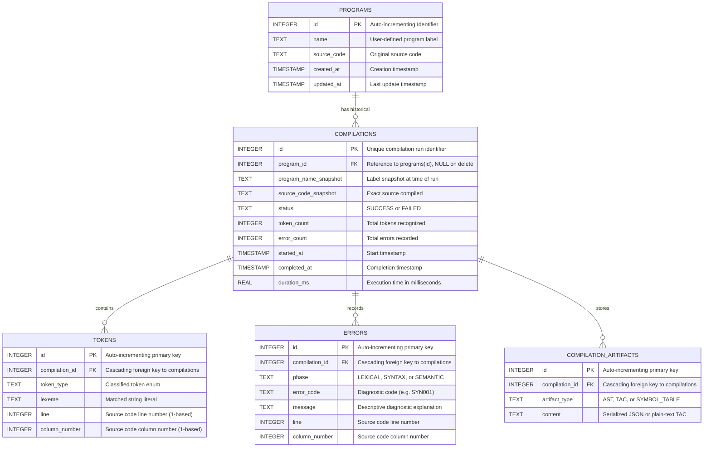

# SQLite Database Schema & Data Dictionary

## 1. Overview
The database engine for this application is **SQLite**, stored locally in `compiler.db`. The database operates fully in-process without requiring an external server daemon, and enforces relational integrity via foreign key constraints (`PRAGMA foreign_keys = ON;`).

---

## 2. Entity-Relationship (ER) Diagram

---

## 3. Data Dictionary

### 3.1 Table: `programs`
Stores user-saved programs.
| Column | Type | Constraints | Description |
| :--- | :--- | :--- | :--- |
| `id` | `INTEGER` | `PRIMARY KEY AUTOINCREMENT` | Unique identifier for each saved program. |
| `name` | `TEXT` | `NOT NULL` | User-assigned script name. |
| `source_code` | `TEXT` | `NOT NULL` | Multiline C-like program text. |
| `created_at` | `TIMESTAMP` | `DEFAULT CURRENT_TIMESTAMP` | Initial save timestamp. |
| `updated_at` | `TIMESTAMP` | `DEFAULT CURRENT_TIMESTAMP` | Last modification timestamp. |

### 3.2 Table: `compilations`
Stores every compilation attempt with immutable snapshots.
| Column | Type | Constraints | Description |
| :--- | :--- | :--- | :--- |
| `id` | `INTEGER` | `PRIMARY KEY AUTOINCREMENT` | Unique run identifier. |
| `program_id` | `INTEGER` | `NULLABLE, FK -> programs(id)` | Associated program (`ON DELETE SET NULL`). |
| `program_name_snapshot`| `TEXT` | | Program label at time of execution. |
| `source_code_snapshot` | `TEXT` | `NOT NULL` | Immutable copy of compiled source. |
| `status` | `TEXT` | `NOT NULL` | Compilation status: `SUCCESS` or `FAILED`. |
| `token_count` | `INTEGER` | `NOT NULL DEFAULT 0` | Total recognized tokens (excluding EOF). |
| `error_count` | `INTEGER` | `NOT NULL DEFAULT 0` | Total diagnostics detected. |
| `started_at` | `TIMESTAMP` | `DEFAULT CURRENT_TIMESTAMP` | Run initiation time. |
| `completed_at` | `TIMESTAMP` | `DEFAULT CURRENT_TIMESTAMP` | Run finish time. |
| `duration_ms` | `REAL` | `NOT NULL DEFAULT 0.0` | Total compilation elapsed time in milliseconds. |

### 3.3 Table: `tokens`
Persists the individual tokens generated during a compilation run.
| Column | Type | Constraints | Description |
| :--- | :--- | :--- | :--- |
| `id` | `INTEGER` | `PRIMARY KEY AUTOINCREMENT` | Unique token record ID. |
| `compilation_id`| `INTEGER` | `NOT NULL, FK -> compilations(id)` | Foreign key (`ON DELETE CASCADE`). |
| `token_type` | `TEXT` | `NOT NULL` | Classified TokenType enum value. |
| `lexeme` | `TEXT` | `NOT NULL` | Exact character sequence. |
| `line` | `INTEGER` | `NOT NULL` | 1-based source line. |
| `column_number` | `INTEGER` | `NOT NULL` | 1-based source column. |

### 3.4 Table: `errors`
Persists error diagnostics from lexical, syntactic, and semantic phases.
| Column | Type | Constraints | Description |
| :--- | :--- | :--- | :--- |
| `id` | `INTEGER` | `PRIMARY KEY AUTOINCREMENT` | Unique diagnostic error record ID. |
| `compilation_id`| `INTEGER` | `NOT NULL, FK -> compilations(id)` | Foreign key (`ON DELETE CASCADE`). |
| `phase` | `TEXT` | `NOT NULL` | Phase name: `LEXICAL`, `SYNTAX`, or `SEMANTIC`. |
| `error_code` | `TEXT` | `NOT NULL` | Standardized diagnostic code (e.g., `LEX001`). |
| `message` | `TEXT` | `NOT NULL` | Clear educational error message. |
| `line` | `INTEGER` | `NULLABLE` | Source line where error occurred. |
| `column_number` | `INTEGER` | `NULLABLE` | Source column where error occurred. |

### 3.5 Table: `compilation_artifacts`
Stores structured compiler artifacts for past runs.
| Column | Type | Constraints | Description |
| :--- | :--- | :--- | :--- |
| `id` | `INTEGER` | `PRIMARY KEY AUTOINCREMENT` | Artifact ID. |
| `compilation_id`| `INTEGER` | `NOT NULL, FK -> compilations(id)` | Foreign key (`ON DELETE CASCADE`). |
| `artifact_type` | `TEXT` | `NOT NULL` | Artifact type: `AST`, `TAC`, or `SYMBOL_TABLE`. |
| `content` | `TEXT` | `NOT NULL` | Serialized JSON or plain text data. |

---

## 4. Performance Indexes
- `idx_compilations_program_id`: Accelerates queries for a specific program's runs.
- `idx_compilations_started_at`: Accelerates chronology ordering for the dashboard and history log.
- `idx_tokens_compilation_id`: Optimizes token inspection for selected runs.
- `idx_errors_compilation_id`: Optimizes error retrieval for past compilations.

